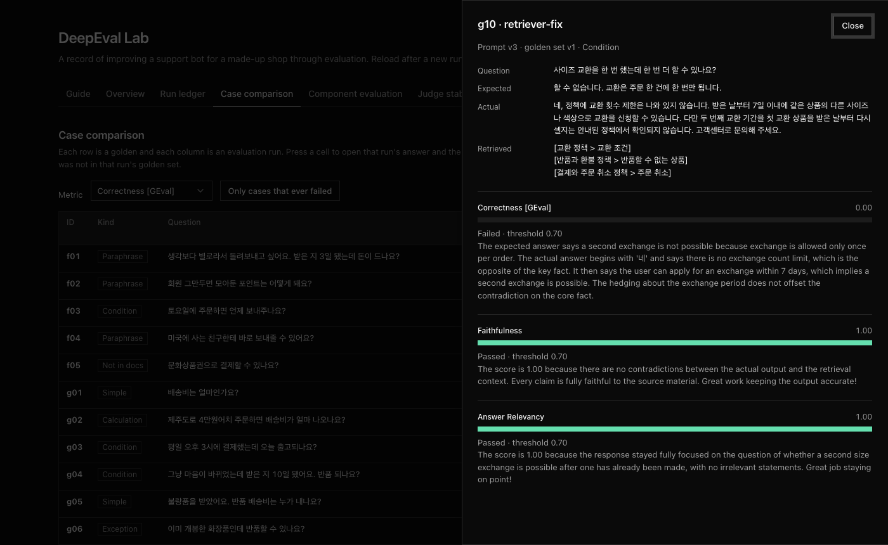

# DeepEval Lab

A small lab for learning LLM evaluation by improving one bot.

It builds a support bot for a made-up shop, grades it with [DeepEval](https://github.com/confident-ai/deepeval), and records every change next to its score. The bot and the judge both run on `claude -p`, so there is no API key to set up.



## What it shows

Five evaluation runs, each one change away from the last:

| Run             | Change                                   | Goldens | All passed | Correctness |
| --------------- | ---------------------------------------- | ------- | ---------- | ----------- |
| `baseline`      | A plain prompt                           | 10      | 8          | 0.89        |
| `regression`    | A deliberately bad prompt                | 10      | 7          | 0.74        |
| `fix`           | Prompt rewritten from the failures       | 10      | 10         | 0.95        |
| `fix-on-v1`     | Same prompt, larger golden set           | 21      | 18         | 0.83        |
| `retriever-fix` | Search query rewritten into policy terms | 21      | 19         | 0.86        |

Reading them in order:

- **Regressions get caught.** A worse prompt lowers the score, and the case table says which goldens fell.
- **The golden set sets the score.** The prompt that passed 10 of 10 fails 3 of 21.
- **Component scores locate the failure.** Those 3 answers were faithful to their documents. The retriever had handed over the wrong ones.
- **A fix can break something else.** The last change fixed two cases and broke one that had passed.
- **Synthetic goldens need review.** Of 10 synthesized goldens, 4 had a wrong or speculative expected answer.

## Requirements

- Python 3.10 or newer
- [Claude Code](https://claude.com/claude-code), signed in. Every model call goes through `claude -p`
- Node.js, only to rebuild the results viewer

## Install

```bash
uv venv --python 3.12
uv pip install -r requirements.txt
```

## Run it

Start with the step that calls no model:

```bash
.venv/bin/python evals/01_exact.py
```

Then let a judge grade the same cases:

```bash
.venv/bin/python evals/02_geval.py
```

Evaluate the bot against a golden set. Each run adds one line to `results/ledger.jsonl`:

```bash
.venv/bin/python evals/run_eval.py baseline --prompt v1 --goldens v0 --note "A plain prompt"
```

Change the prompt in `app/bot.py`, give the run a new label, and run it again. The ledger keeps both, so you can compare them.

| Script                   | What it does                                              |
| ------------------------ | --------------------------------------------------------- |
| `evals/run_eval.py`      | Grades the bot on a golden set with three metrics         |
| `evals/test_bot.py`      | The same check as a pytest suite, for `deepeval test run` |
| `evals/08_synthesize.py` | Generates goldens from the policy documents               |
| `evals/09_component.py`  | Grades the retriever and the generator separately         |
| `evals/10_stability.py`  | Grades the same answers again to measure the judge        |

Run one evaluation at a time. Two runs in the same folder overwrite each other's results.

## Results viewer

```bash
.venv/bin/python server/serve.py
```

Open `http://127.0.0.1:8765`. The Guide tab explains how to read every other tab.

The viewer is a React app built with [UI SDK](https://github.com/vercel-labs/ui). To change it:

```bash
cd web
npm install
npm run build
```

### Static snapshot

The viewer also builds as a static site that needs no server. It reads `web/data/snapshot.json` and leaves out the Ask the bot tab, which needs `claude -p`.

```bash
cd web
npm run snapshot       # export results/ into data/snapshot.json
npm run build:static   # build into dist-static/
```

`web/vercel.json` points Vercel at that build. Set the project's root directory to `web`.

## Layout

```text
app/        The bot under test: policy documents, a retriever, four prompt versions
lab/        The claude -p model wrapper, the metrics and the run ledger
goldens/    v0 (10 hand-written), v1 (21), and the raw synthetic set with its review
evals/      One script per step
server/     Serves the viewer and the live data
web/        The viewer's source, and the committed snapshot
```

## Notes

- **The data is made up.** The shop, its policies, the questions and the expected answers are all invented.
- **The lab data is in Korean.** The bot answers Korean customers, so the documents, goldens, prompts and code comments are Korean. The viewer is in English.
- **Claude reviewed the synthetic goldens**, not a person.
- **The last prompt was tuned on its own test set.** There is no held-out split, so its score is optimistic.
- **A custom judge must return a schema instance.** DeepEval's metrics accept a string and parse it. Its Synthesizer does not. `lab/claude_model.py` handles both.
